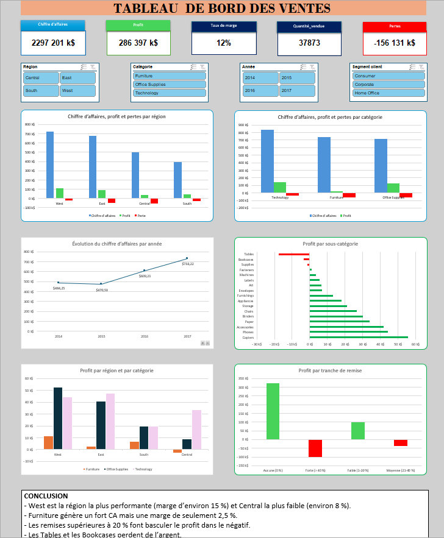

# 📊 Analyse et visualisation des performances des ventes avec Excel

## 📌 Présentation du projet

Ce projet consiste à analyser et visualiser les performances commerciales d'une entreprise à l'aide de Microsoft Excel, à travers la conception d'un tableau de bord interactif.

L'objectif est de faciliter le suivi des ventes par région et par catégorie de produits afin d'identifier les zones de performance et les axes d'amélioration.

## 🎯 Problématique métier

Une entreprise souhaite suivre les performances de ses ventes par région et catégorie pour identifier les zones à améliorer.

## 🎯 Objectifs du projet

Créer un tableau de bord interactif permettant d'analyser les principaux indicateurs de performance (KPI), notamment :
- Le chiffre d'affaires.
- Les marges commerciales.
- Les performances régionales.
- Les performances par catégorie de produits.

## 🛠️ Outils et compétences techniques

**Outil utilisé :** Microsoft Excel.

Compétences mobilisées :
- Nettoyage et organisation des données.
- Utilisation des formules Excel : SOMME, SOMME.SI, MOYENNE, RECHERCHEV, INDEX et EQUIV.
- Création de tableaux croisés dynamiques.
- Utilisation de segments pour faciliter la navigation et le filtrage des données.
- Création de graphiques dynamiques.
- Conception d'un tableau de bord interactif.

## 📷 Aperçu du tableau de bord



## 📁 Structure du dépôt

```text
analyse-performances-ventes-excel/
│
├── fichier/
│   └── tableau_de_bord_ventes.xlsx
│
├── captures/
│   └── dashboard.png
│
├── documentation/
│
└── README.md
```

## 📂 Source des données

Le projet utilise le jeu de données **Superstore Dataset Final**, disponible sur Kaggle.

- **Plateforme :** Kaggle
- **Auteur du jeu de données :** vivek468
- **Lien :** [Superstore Dataset Final](https://www.kaggle.com/datasets/vivek468/superstore-dataset-final)

## 👨‍💻 Auteur

**NKB_DATA**

Étudiant en BUT 2 Sciences des Données – Parcours VCOD  
IUT de Lille – Site de Roubaix.
